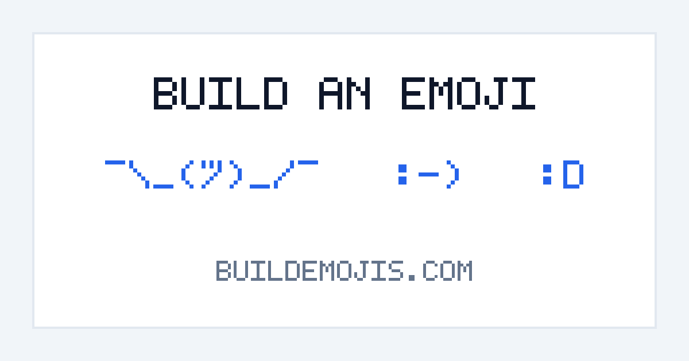

# Build an Emoji — [buildemojis.com](https://buildemojis.com/)

[](https://buildemojis.com/)

**Build an Emoji** is an interactive browser puzzle game where you drag and drop scattered typographic character pieces across the canvas to assemble classic text emoticons and Japanese kaomoji (such as `:)`, `¯\_(ツ)_/¯`, and `(╯°□°)╯︵┻┻`).

Inspired by the quirky web toy [buildshruggie.com](https://buildshruggie.com/).

---

## 🎮 How to Play

1. Open **[https://buildemojis.com/](https://buildemojis.com/)**.
2. Check the target emoticon name in the top-left corner (e.g., **Smile**, **Rose**, **Shrug**, **Table flip**).
3. **Drag and drop** the scattered character pieces using your mouse, trackpad, or touchscreen to arrange them into the emoticon.
4. Once all pieces are aligned within the target tolerance, they automatically snap into place!
5. **Controls:**
   - **Previous / Next (`«` / `»` icons) & Level Picker:** Switch between all 16 emoticon levels.
   - **Outline:** Toggle a subtle silhouette hint inside the center assembly zone.
   - **Reset:** Scatter character pieces across the screen again.
   - **Robot (`Do it for me`):** Automatically assemble the current emoticon.
   - **Copy / Copy Link:** Copy the assembled emoticon text or a shareable `?smile=<id>&done` showcase link.

### URL Parameters
- `?smile=<id>` — Load a specific emoticon puzzle (for example, [`?smile=shrug`](https://buildemojis.com/?smile=shrug)).
- `?smile=<id>&done` — Open a puzzle in its completed (assembled) state (for example, [`?smile=shrug&done`](https://buildemojis.com/?smile=shrug&done)).

---

## 🧩 Playable Emoticons & Kaomoji (16 Levels)

| # | ID (`?smile=`) | Title | Emoticon / Kaomoji | Pieces | Play Link |
| :-: | :--- | :--- | :---: | :-: | :--- |
| 1 | `smile` | Smile | `:)` | 2 | [Play](https://buildemojis.com/?smile=smile) |
| 2 | `laughing` | Laughing | `:D` | 2 | [Play](https://buildemojis.com/?smile=laughing) |
| 3 | `tears_of_happiness` | Tears of happiness | `:')` | 3 | [Play](https://buildemojis.com/?smile=tears_of_happiness) |
| 4 | `surprise` | Surprise | `:-O` | 3 | [Play](https://buildemojis.com/?smile=surprise) |
| 5 | `kiss` | Kiss | `:-*` | 3 | [Play](https://buildemojis.com/?smile=kiss) |
| 6 | `wink` | Wink | `; -)` | 3 | [Play](https://buildemojis.com/?smile=wink) |
| 7 | `tongue_sticking_out` | Tongue sticking out | `:-P` | 3 | [Play](https://buildemojis.com/?smile=tongue_sticking_out) |
| 8 | `angel` | Angel | `O:-)` | 4 | [Play](https://buildemojis.com/?smile=angel) |
| 9 | `evil` | Evil | `>:-)` | 4 | [Play](https://buildemojis.com/?smile=evil) |
| 10 | `rose` | Rose | `@}->--` | 6 | [Play](https://buildemojis.com/?smile=rose) |
| 11 | `shock` | Shock | `(O_O)` | 5 | [Play](https://buildemojis.com/?smile=shock) |
| 12 | `troubled` | Troubled | `(>_<)` | 5 | [Play](https://buildemojis.com/?smile=troubled) |
| 13 | `excited` | Excited | `\(^o^)/` | 7 | [Play](https://buildemojis.com/?smile=excited) |
| 14 | `worried` | Worried | `(-_-メ)` | 6 | [Play](https://buildemojis.com/?smile=worried) |
| 15 | `shrug` | Shrug | `¯\_(ツ)_/¯` | 9 | [Play](https://buildemojis.com/?smile=shrug) |
| 16 | `table_flip` | Table flip | `(╯°□°)╯︵┻┻` | 10 | [Play](https://buildemojis.com/?smile=table_flip) |

---

## 🛠️ Tech Stack & Project Structure

The project is built with **zero external runtime dependencies** using modern Vanilla JavaScript (`Pointer Events API`, `Web Animations API`, `HTML5 Canvas 2D`), semantic HTML5, and CSS3.

All deployable production web files live inside [`public/`](public/), ensuring that repository documentation and test files are never exposed on the production domain.

```text
buildemojis.com/
├── .github/
│   ├── workflows/
│   │   ├── ci.yml               # Runs automated test suite on Pull Requests
│   │   └── deploy.yml           # Deploys ./public to GitHub Pages on push to main
│   └── CODEOWNERS
├── docs/
│   ├── completed.md             # Archive of completed improvements & features
│   └── improvements.md          # Active backlog of remaining improvements
├── public/                      # Production web root deployed to buildemojis.com
│   ├── css/
│   │   └── styles.css           # Layout and canvas styles
│   ├── image/
│   │   ├── apple-touch-icon.png # 180x180 iOS/Android home screen icon
│   │   ├── favicon.svg          # Vector browser favicon
│   │   ├── next.svg             # Vector "Next emoji" icon
│   │   ├── og-preview.png       # 1200x630 Open Graph / social preview banner
│   │   └── robot.svg            # Vector "Do it for me" robot icon
│   ├── js/
│   │   ├── data.js              # Definitions and geometry for all 16 emoticon levels
│   │   └── script.js            # Core game engine, drag-and-drop, SEO meta & GA4 events
│   ├── CNAME                    # Custom domain configuration (buildemojis.com)
│   ├── favicon.ico              # Multi-size legacy ICO favicon
│   ├── index.html               # Main application entry point (with JSON-LD & OG tags)
│   ├── llms.txt                 # AI / LLM crawler manifest (GEO)
│   ├── robots.txt               # Search engine & AI crawler rules
│   ├── sitemap.xml              # XML Sitemap covering all 16 emoticon levels
│   └── site.webmanifest         # Progressive Web App manifest
├── tests/
│   └── test.js                  # Zero-dependency Node.js test suite
├── .gitignore
├── LICENSE.txt
└── README.md
```

---

## 🚀 Running Locally & Testing

### Run the Game Locally
Since the project uses pure static files with zero build step required, you can either open `public/index.html` directly in your browser or serve the `public/` directory via any static HTTP server:

```bash
npx serve public
# or
python -m http.server 8080 --directory public
```

### Run Automated Tests
The repository includes a built-in zero-dependency test suite (`tests/test.js`) that validates JavaScript syntax, level definitions in `public/js/data.js`, Pointer Events drag-and-drop mechanics, puzzle completion logic, `public/` deployment isolation, SVG/PNG assets, and SEO/GEO metadata:

```bash
node tests/test.js
```

---

## ➕ Adding a New Emoji

To add a new emoticon level, add a new entry to the `data` object in [`public/js/data.js`](public/js/data.js):

```javascript
my_emoji: {
    title: 'My Emoji',
    modelStyleFix: { left: 0.90 }, // Optional horizontal centering adjustment
    model: [
        { character: ':', canvas: { height: 1, width: 1, right: 0, down: 0 } },
        { character: '-', canvas: { height: 1, width: 1, right: 0, down: 0 } },
        { character: ')', canvas: { height: 1, width: 1, right: 0, down: 0 } }
    ]
}
```

---

## 👤 Author & License

- **Author:** [Sergey Demyanenko](https://www.linkedin.com/in/sergey-demyanenko/) ([GitHub](https://github.com/SergeiDemyanenko))
- **License:** Licensed under the [MIT License](LICENSE.txt).
